# Домашнее задание к занятию «Системы мониторинга» - Никифоров Роман Сергеевич

Обязательные задания

   1. Вас пригласили настроить мониторинг на проект. На онбординге вам рассказали, что проект представляет из себя платформу для вычислений с выдачей текстовых отчетов, которые сохраняются на диск. Взаимодействие с платформой осуществляется по протоколу http. Также вам отметили, что вычисления загружают ЦПУ. Какой минимальный набор метрик вы выведите в мониторинг и почему?

   2. Менеджер продукта посмотрев на ваши метрики сказал, что ему непонятно что такое RAM/inodes/CPUla. Также он сказал, что хочет понимать, насколько мы выполняем свои обязанности перед клиентами и какое качество обслуживания. Что вы можете ему предложить?

   3. Вашей DevOps команде в этом году не выделили финансирование на построение системы сбора логов. Разработчики в свою очередь хотят видеть все ошибки, которые выдают их приложения. Какое решение вы можете предпринять в этой ситуации, чтобы разработчики получали ошибки приложения?

   4. Вы, как опытный SRE, сделали мониторинг, куда вывели отображения выполнения SLA=99% по http кодам ответов. Вычисляете этот параметр по следующей формуле: summ_2xx_requests/summ_all_requests. Данный параметр не поднимается выше 70%, но при этом в вашей системе нет кодов ответа 5xx и 4xx. Где у вас ошибка?

   5. Опишите основные плюсы и минусы pull и push систем мониторинга.

   6. Какие из ниже перечисленных систем относятся к push модели, а какие к pull? А может есть гибридные?
        Prometheus
        TICK
        Zabbix
        VictoriaMetrics
        Nagios

   7. Склонируйте себе репозиторий и запустите TICK-стэк, используя технологии docker и docker-compose.

В виде решения на это упражнение приведите скриншот веб-интерфейса ПО chronograf (http://localhost:8888).

P.S.: если при запуске некоторые контейнеры будут падать с ошибкой - проставьте им режим Z, например ./data:/var/lib:Z

   8. Перейдите в веб-интерфейс Chronograf (http://localhost:8888) и откройте вкладку Data explorer.
        Нажмите на кнопку Add a query
        Изучите вывод интерфейса и выберите БД telegraf.autogen
        В measurments выберите cpu->host->telegraf-getting-started, а в fields выберите usage_system. Внизу появится график утилизации cpu.
        Вверху вы можете увидеть запрос, аналогичный SQL-синтаксису. Поэкспериментируйте с запросом, попробуйте изменить группировку и интервал наблюдений.

Для выполнения задания приведите скриншот с отображением метрик утилизации cpu из веб-интерфейса.

   9. Изучите список telegraf inputs. Добавьте в конфигурацию telegraf следующий плагин - docker:

[[inputs.docker]]
  endpoint = "unix:///var/run/docker.sock"

Дополнительно вам может потребоваться донастройка контейнера telegraf в docker-compose.yml дополнительного volume и режима privileged:

  telegraf:
    image: telegraf:1.4.0
    privileged: true
    volumes:
      - ./etc/telegraf.conf:/etc/telegraf/telegraf.conf:Z
      - /var/run/docker.sock:/var/run/docker.sock:Z
    links:
      - influxdb
    ports:
      - "8092:8092/udp"
      - "8094:8094"
      - "8125:8125/udp"

После настройке перезапустите telegraf, обновите веб интерфейс и приведите скриншотом список measurments в веб-интерфейсе базы telegraf.autogen . Там должны появиться метрики, связанные с docker.

Факультативно можете изучить какие метрики собирает telegraf после выполнения данного задания.
Дополнительное задание (со звездочкой*) - необязательно к выполнению

  1. Вы устроились на работу в стартап. На данный момент у вас нет возможности развернуть полноценную систему мониторинга, и вы решили самостоятельно написать простой python3-скрипт для сбора основных метрик сервера. Вы, как опытный системный-администратор, знаете, что системная информация сервера лежит в директории /proc. Также, вы знаете, что в системе Linux есть планировщик задач cron, который может запускать задачи по расписанию.

Суммировав все, вы спроектировали приложение, которое:

    является python3 скриптом

    собирает метрики из папки /proc

    складывает метрики в файл 'YY-MM-DD-awesome-monitoring.log' в директорию /var/log (YY - год, MM - месяц, DD - день)

    каждый сбор метрик складывается в виде json-строки, в виде:

        timestamp (временная метка, int, unixtimestamp)

        metric_1 (метрика 1)

        metric_2 (метрика 2)

        ...

        metric_N (метрика N)

    сбор метрик происходит каждую 1 минуту по cron-расписанию

Для успешного выполнения задания нужно привести:

а) работающий код python3-скрипта,

б) конфигурацию cron-расписания,

в) пример верно сформированного 'YY-MM-DD-awesome-monitoring.log', имеющий не менее 5 записей,

P.S.: количество собираемых метрик должно быть не менее 4-х. P.P.S.: по желанию можно себя не ограничивать только сбором метрик из /proc.

  2. В веб-интерфейсе откройте вкладку Dashboards. Попробуйте создать свой dashboard с отображением:
        утилизации ЦПУ
        количества использованного RAM
        утилизации пространства на дисках
        количество поднятых контейнеров
        аптайм
        ...
        фантазируйте)

Как оформить ДЗ?

Выполненное домашнее задание пришлите ссылкой на .md-файл в вашем репозитории.

------

  Задание 1.
  
  Минимальный набор метрик:

   Загрузка CPU (CPU utilization) — вычисления нагружают процессор. Высокая загрузка может привести к увеличению времени отклика и таймаутам. Метрика покажет, справляется ли платформа с нагрузкой или требуется масштабирование.

   Использование RAM (Memory usage) — вычисления и генерация отчётов потребляют память. Нехватка RAM приводит к использованию swap (резкое падение производительности) или к OOM-killer (аварийное завершение процессов).

   Свободное место на диске (Disk space) — отчёты сохраняются на диск. Заполнение диска остановит генерацию новых отчётов и может нарушить работу всей системы.

   Количество HTTP-запросов и коды ответов (HTTP request rate & status codes) — платформа взаимодействует по HTTP. Рост доли ошибок (5xx) или увеличение времени ответа сигнализирует о проблемах в приложении или инфраструктуре.

   Время ответа (Response time / Latency) — ключевая метрика для пользователей. Даже при низкой загрузке CPU высокое время ответа может указывать на проблемы с диском, сетью или блокировки в приложении.
  
------

  Задание 2.

  SLI (Service Level Indicator) — измеримый показатель качества услуги. Примеры для нашей платформы:

   Доступность (Availability): доля успешных HTTP-запросов (коды 2xx и 3xx) от общего числа.

   Время ответа (Latency): 95-й перцентиль времени ответа (например, 95% запросов обрабатываются быстрее 500 мс).

   Успешность вычислений: доля отчётов, сгенерированных без ошибок.

  SLO (Service Level Objective) — целевое значение SLI. Например: «Доступность ≥ 99.9% в месяц», «95% запросов быстрее 1 секунды».

  SLA (Service Level Agreement) — юридическое соглашение с клиентом, где прописаны SLO и последствия их нарушения (компенсации, штрафы).
  
  Возможно предоставить дашборд с графиками SLI (доступность, latency, успешность отчётов) и отчёт о выполнении SLO за период.

------

  Задание 3.

  Решения:

   1. Централизованный сбор через rsyslog/syslog-ng — настроить отправку логов приложений на центральный сервер по протоколу syslog (UDP/TCP 514). Это бесплатно и встроено в Linux. Можно использовать rsyslog с фильтрацией по facility/severity.

   2. Ротация и хранение на локальных дисках с последующей выгрузкой — настроить logrotate для приложений, а разработчики могут забирать архивы логов по запросу (например, через scp или общую папку).

   3. Использование бесплатных облачных тарифов — некоторые сервисы (например, Grafana Loki в self-hosted варианте, или бесплатные tier'ы Sentry, Loggly) позволяют собирать логи в ограниченном объёме бесплатно.

   4. Скрипт-агрегатор — простой Python/Bash-скрипт, который периодически собирает логи ошибок из файлов приложений и складывает их в общую директорию или отправляет разработчикам по email.

  Можно начать с rsyslog + logrotate — это минимальные затраты и быстрое внедрение.

------

  Задание 4.
  
  1. В знаменателе учитываются запросы, которые не являются «пользовательскими» HTTP-запросами.
    Например, health-check'и (проверки доступности) могут возвращать коды, отличные от 2xx (например, 3xx редиректы, или 1xx информационные), или это могут быть запросы к служебным эндпоинтам, которые не должны входить в расчёт SLA. Если summ_all_requests включает все запросы, а summ_2xx_requests — только успешные, то наличие большого числа 3xx (редиректов) или 1xx снизит показатель.

  2. Ошибка в определении «успешного» запроса.
    В некоторых системах успешными считаются не только 2xx, но и 3xx (редиректы). Если в вашей системе много редиректов (например, с HTTP на HTTPS), а вы считаете успешными только 2xx, SLA будет занижен.

  3. Некорректный сбор метрик.
    Возможно, счётчик summ_all_requests включает запросы, которые не дошли до приложения (например, ошибки на уровне балансировщика, таймауты, которые не фиксируются как HTTP-коды). Или же счётчик summ_2xx_requests собирает данные не по всем эндпоинтам.

  Нужно пересмотреть формулу. Для SLA по доступности обычно используют: (summ_2xx + summ_3xx) / summ_all_requests или явно исключают служебные запросы. Также стоит проверить, не учитываются ли в знаменателе запросы с кодами 1xx.

------

  Задание 5.
  
  Pull (вытягивание): сервер мониторинга сам периодически опрашивает агентов/экспортёры по HTTP (или другому протоколу).
  Плюсы:
  – Легче контролировать нагрузку на сервер мониторинга (он сам задаёт частоту).
  – Проще обнаружить «мёртвые» хосты (если цель не отвечает, это сразу видно).
  – Централизованная конфигурация целей.
  Минусы:
  – Требуется сетевой доступ от сервера к агентам.
  – Сложнее для динамических сред (нужна service discovery).
  – Агент должен поддерживать endpoint для опроса.
  
  Push (проталкивание): агенты самостоятельно отправляют метрики на центральный сервер.
  Плюсы:
  – Не требует, чтобы сервер мониторинга имел доступ к агенту (удобно для динамических сред, NAT).
  – Агент может буферизовать данные при недоступности сервера.
  – Проще для кратковременных задач (batch jobs).
  Минусы:
  – Сервер может быть перегружен входящим потоком.
  – Сложнее обнаружить недоступность агента (нужны heartbeat-метрики).
  – Конфигурация агентов распределена.
  
------ 

  Задание 6.
  
  Prometheus, pull модель: сервер сам скрапит метрики с экспортёров по HTTP. Исключение составляет pushgateway для кратковременных задач.
  
  TICK (Telegraf), push модель: telegraf отправляет метрики в InfluxDB.
  
  Zabbix, гибридная модель: классически — push (агенты отправляют данные), но также поддерживает pull (пассивные проверки, когда сервер запрашивает агента).
  
  VictoriaMetrics, pull модель: поддерживает scraping, но также имеет API для push (например, через vmagent).
  
  Nagios, pull модель: сервер опрашивает агентов (NRPE, check_by_ssh) или использует пассивные проверки (гибрид).
  
------

  Задание 7.  
  
  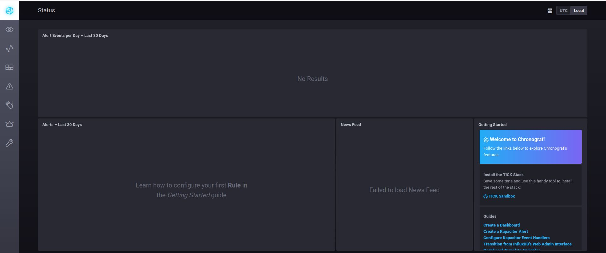

------

  Задание 8. 
       
   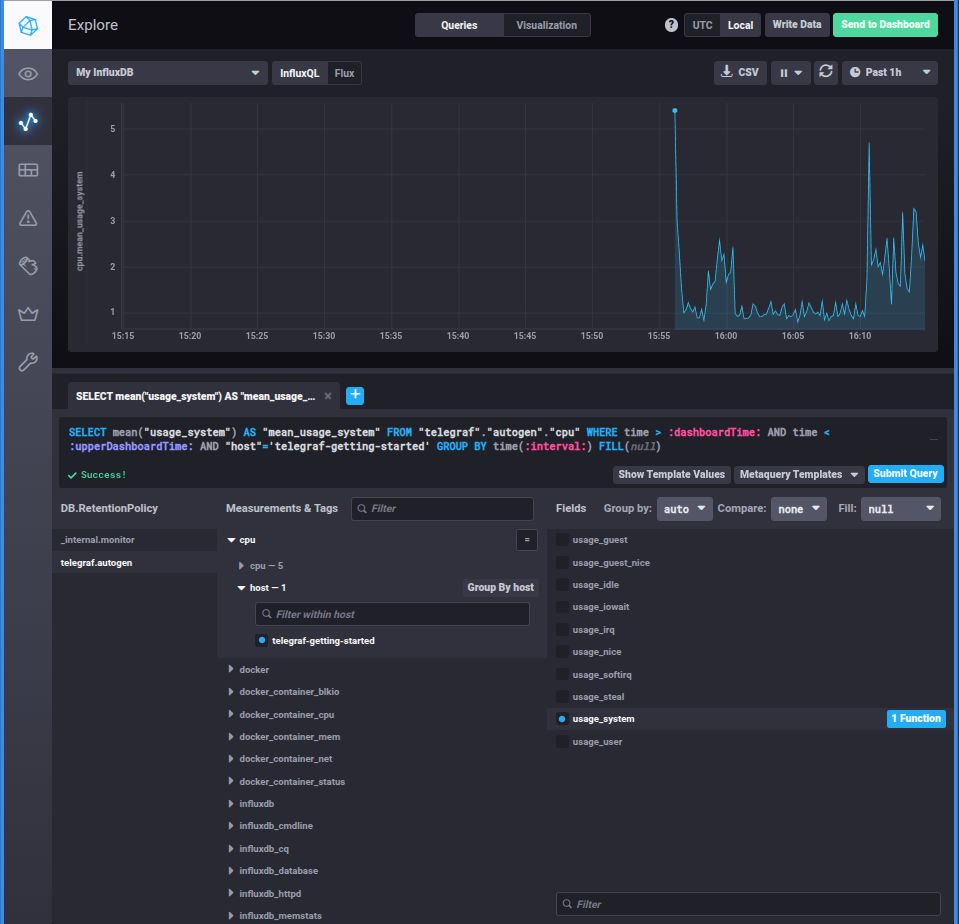
   
   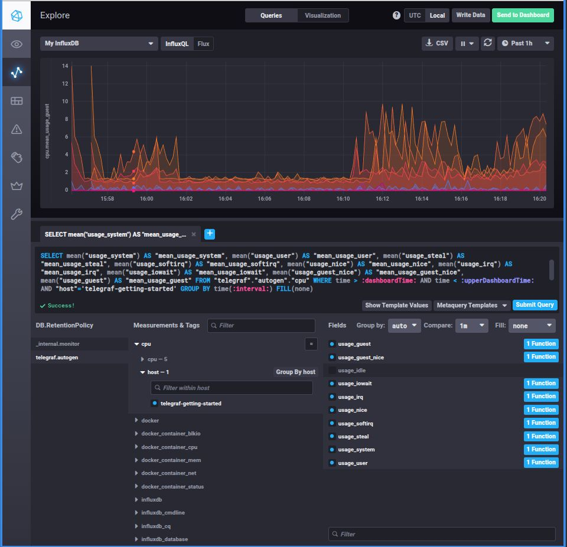
   
------
   
   Задание 9.
   
   [docker-compose.yaml](docker-compose.yaml)
   
   [telegraf.conf](telegraf.conf)
   
   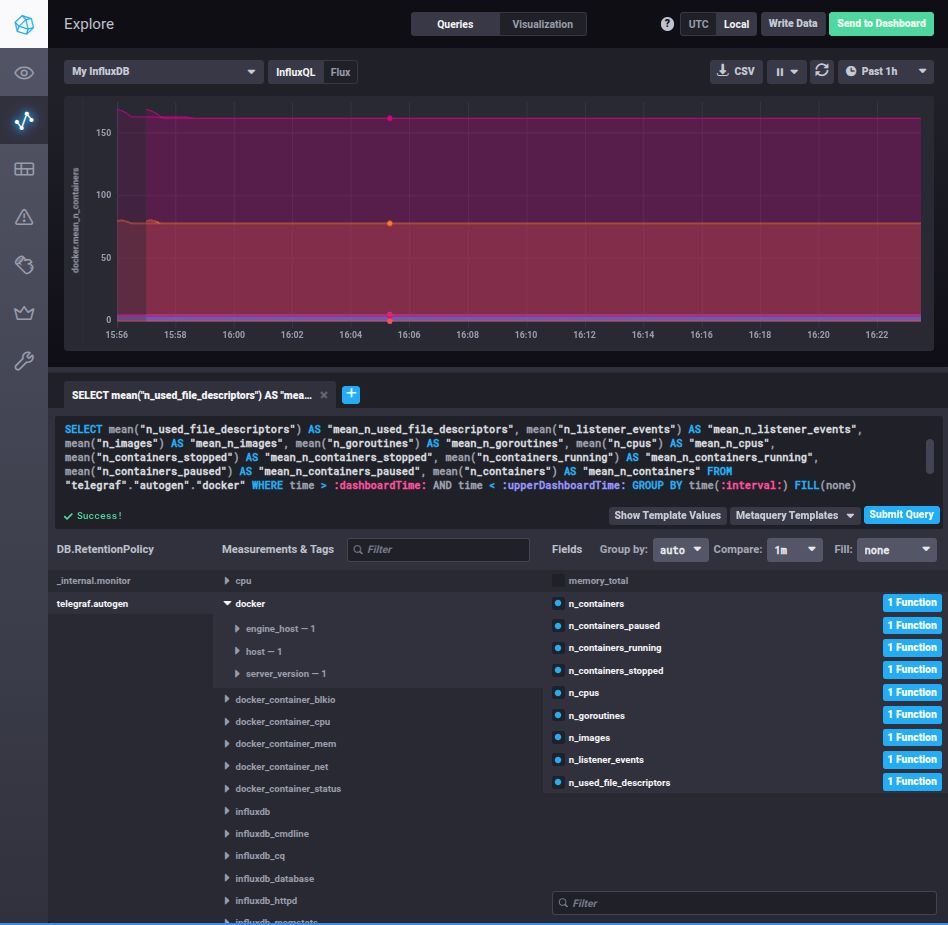
       
------

Дополнительное задание (со звездочкой*) - необязательно к выполнению

  Задание 1.
   
  [monitoring.py](monitoring.py)
  
  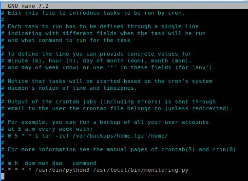
  
  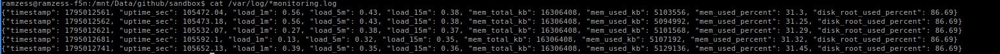
  
------

  Задание 2.

  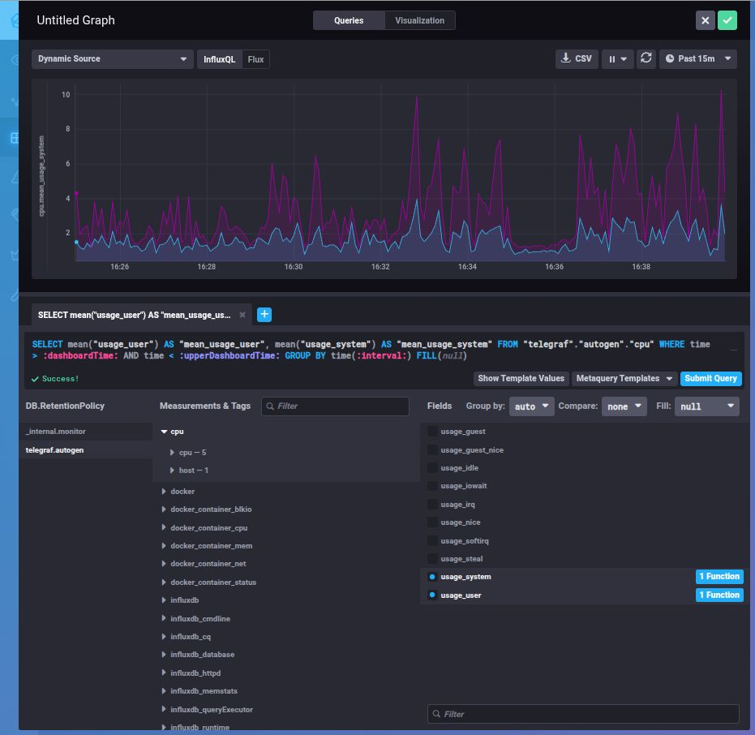
  
  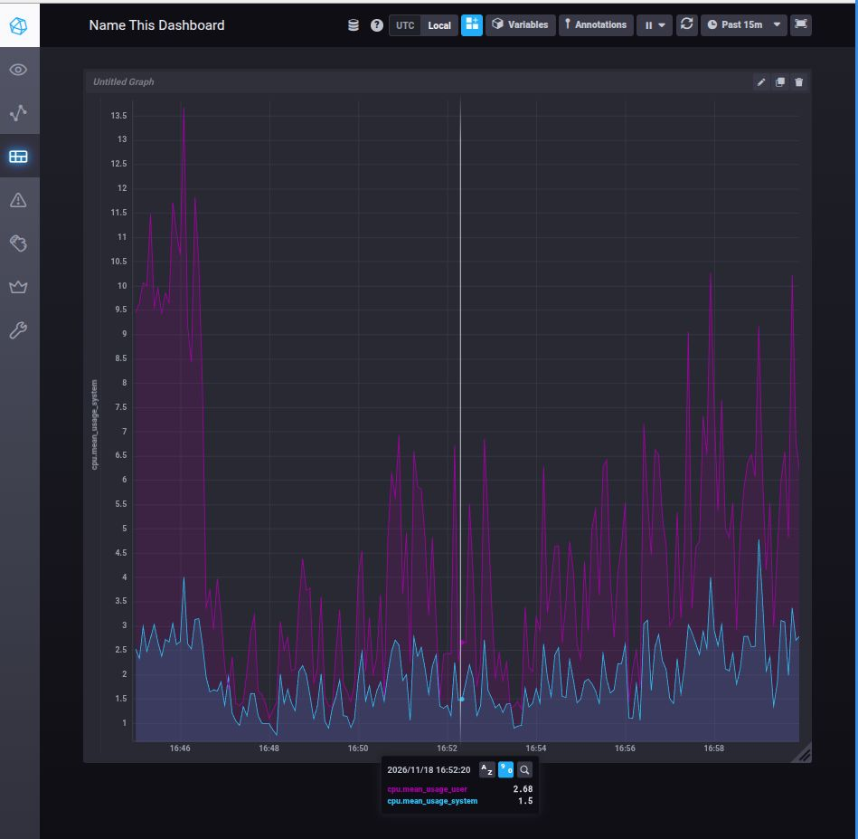
  
  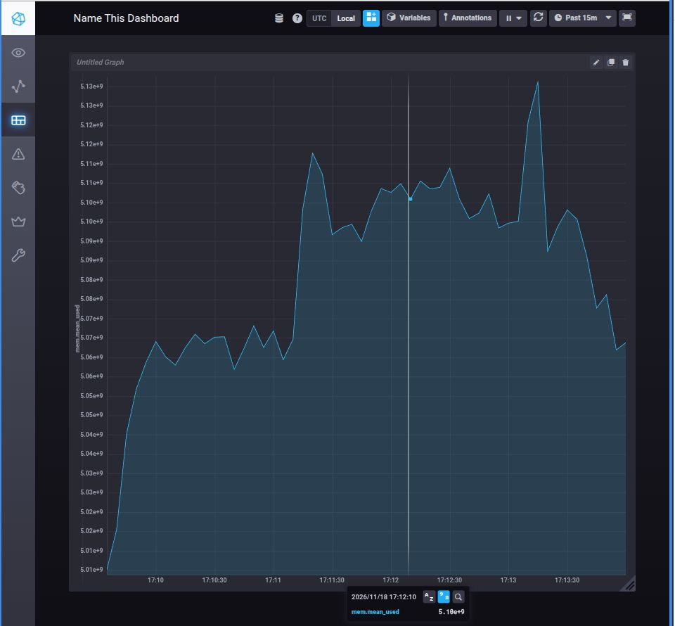
  
  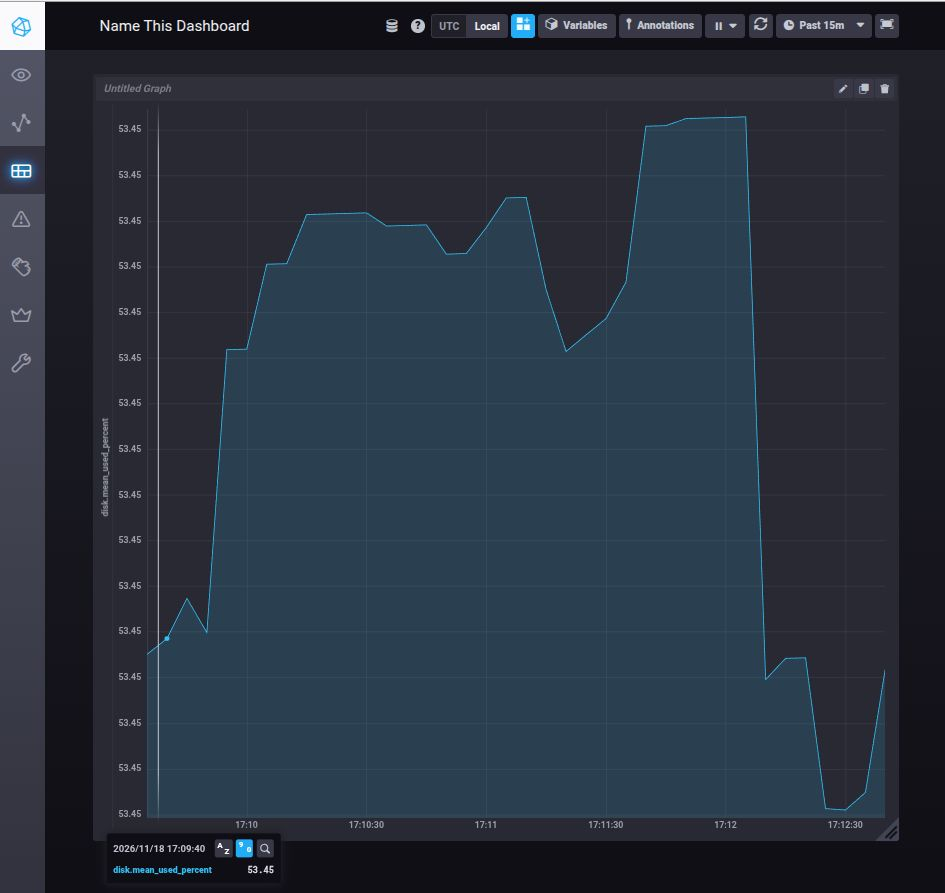
  
  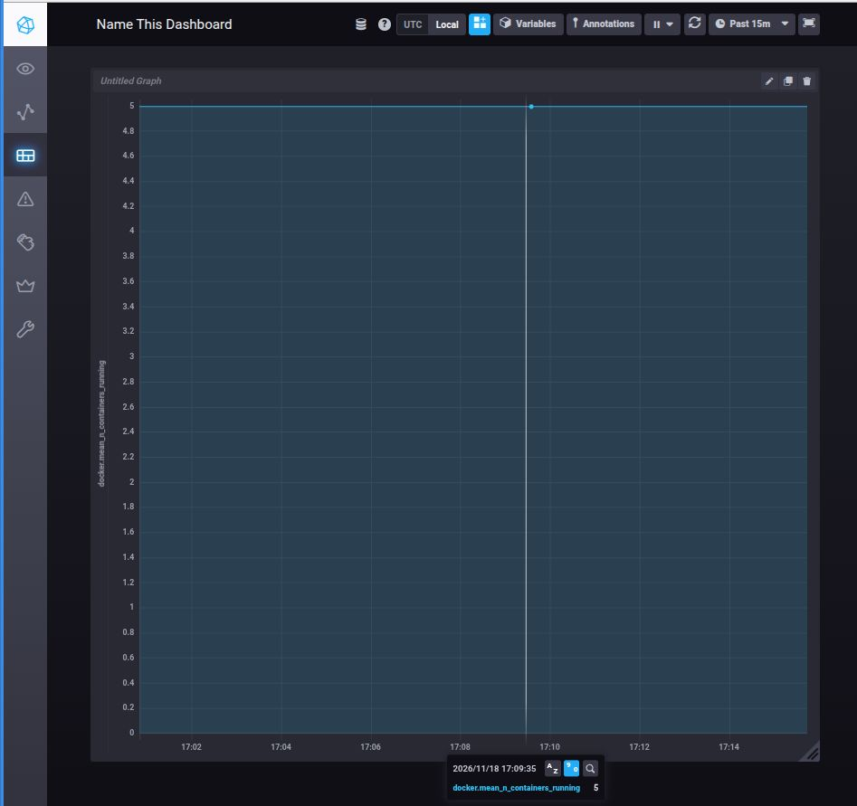
  
  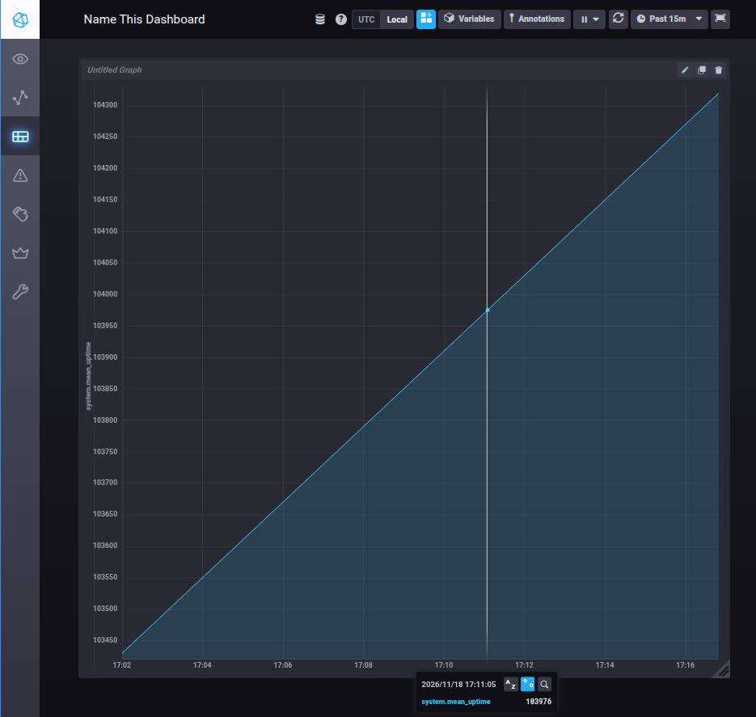

------
